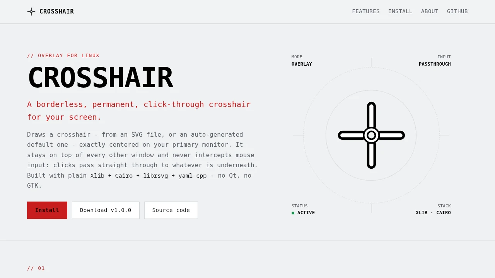

# Crosshair

<a href="https://dlehmann.github.io/crosshair/">
  <picture>
    <source media="(prefers-color-scheme: dark)" srcset="assets/screenshot-dark.webp">
    
  </picture>
</a>

A borderless, permanent, click-through crosshair overlay for Linux desktops.
It draws a crosshair (from an SVG file, or an auto-generated default one)
exactly centered on your primary monitor, stays on top of every other
window, and never intercepts mouse input - clicks pass straight through to
whatever is underneath.

Only one instance runs at a time. The running instance shows up as a normal
entry in your taskbar; opening it (by clicking that entry, or by launching
the program again) reveals a small dialog offering to exit.

Built with plain **Xlib + Cairo + librsvg + yaml-cpp** (no Qt, no GTK) to
keep the binary small, dependency-light, and fast to start.

## Prerequisites & Dependencies

You need a C++17 compiler, CMake, and the development headers for the
libraries used to draw the overlay, parse SVGs, and read the translation
file.

### Arch Linux / CachyOS / Manjaro

```bash
sudo pacman -S --needed base-devel cmake pkgconf libx11 libxext libxrandr cairo librsvg yaml-cpp
```

### Debian / Ubuntu / KDE neon

```bash
sudo apt install build-essential cmake pkg-config libx11-dev libxext-dev libxrandr-dev libcairo2-dev librsvg2-dev libyaml-cpp-dev
```

### Fedora

```bash
sudo dnf install gcc-c++ cmake pkgconf-pkg-config libX11-devel libXext-devel libXrandr-devel cairo-devel librsvg2-devel yaml-cpp-devel
```

Runtime requirements:

- An X server, **or** a Wayland compositor with XWayland available (the
  overlay connects via Xlib either way - see [Technical
  Details](#technical-details--notes)).
- A compositing window manager (KDE Plasma/KWin compositing is enabled by
  default) so the transparent background actually renders as transparent
  instead of opaque black.
- A window manager that follows the ICCCM/EWMH conventions (KWin, Mutter,
  Xfwm, etc.) for the taskbar entry and its minimize/activate behavior to
  work correctly.

No extra dependency is needed for the single-instance check - it uses a
plain POSIX file lock (`flock`), always available in glibc.

Building `crosshair` itself needs nothing beyond the packages above (no
internet access required). **Packaging it as a portable AppImage** (see
below) additionally needs `curl` and `rsvg-convert` (Debian/Ubuntu:
`librsvg2-bin`; Fedora: `librsvg2-tools`; Arch: included in `librsvg`), plus
internet access on first run to download the packaging tools.

## Building & Installation

### Download a pre-built release (easiest)

The simplest way to get `crosshair` is to grab the latest
`crosshair-vX.Y.Z-x86_64.AppImage` from this repository's **Releases** page
on GitHub - no compiler or dependencies needed:

```bash
chmod +x crosshair-*-x86_64.AppImage
./crosshair-*-x86_64.AppImage
```

These releases are built and published automatically by a GitHub Actions
workflow (see [Automated releases (CI)](#5-automated-releases-ci) below)
using the exact same `package-appimage.sh` described further down, so a
downloaded release behaves identically to one you'd build yourself.

If you'd rather build from source - to install it as a regular application,
package it yourself, or modify the code - continue below.

### 1. Build only (no install)

```bash
./build.sh
```

This configures and builds into `./build`, producing `build/crosshair`,
without touching anything outside the project directory. Pass a CMake build
type to override the default (`./build.sh Debug`). Equivalent to running
directly:

```bash
cmake -S . -B build -DCMAKE_BUILD_TYPE=Release
cmake --build build --parallel
```

### 2. Install for the current user (recommended)

The provided `install.sh` builds the project and installs everything into
your user's XDG directories - no root privileges needed:

```bash
./install.sh
```

It installs:

| What | Where |
|---|---|
| Binary + bundled assets | `~/.local/share/crosshair/` |
| Application icon | `~/.local/share/icons/hicolor/scalable/apps/crosshair.svg` |
| `.desktop` launcher | `~/.local/share/applications/crosshair.desktop` |

After installation, **"Crosshair" appears in the KDE Plasma application
launcher** (and in GNOME, XFCE, etc., since it's a standard freedesktop.org
`.desktop` entry) under the "Utility"/"Game" categories. You can also pin it
to the taskbar.

If you'd rather set it up manually, the template used by `install.sh` lives
at `desktop/crosshair.desktop.in` - copy it to
`~/.local/share/applications/crosshair.desktop` and replace `@EXEC_PATH@`
with the absolute path to the binary and `@ICON_NAME@` with an icon name (or
absolute path to an icon file).

### 3. Uninstalling

```bash
rm -rf ~/.local/share/crosshair
rm -f ~/.local/share/icons/hicolor/scalable/apps/crosshair.svg
rm -f ~/.local/share/applications/crosshair.desktop
```

### 4. Building a portable AppImage (for sharing with others)

The methods above produce a binary that's dynamically linked against
whatever library versions happen to be installed on *your* machine - handing
that raw binary to someone else only works if their system has matching
versions of every one of its ~50 shared library dependencies (see [Technical
Details](#technical-details--notes)), which is fragile in practice.

To share a single file that just works on another Linux machine instead,
build an AppImage:

```bash
./package-appimage.sh
```

This produces `build/crosshair-x86_64.AppImage` - a single, self-contained
file bundling `crosshair` together with every shared library it needs
(Cairo, librsvg and its dependency chain, yaml-cpp, ...). Give that one file
to someone else; they just need to:

```bash
chmod +x crosshair-x86_64.AppImage
./crosshair-x86_64.AppImage
```

No installation, no matching library versions required on their end. See
[Technical Details](#technical-details--notes) for what this does and does
not solve.

### 5. Automated releases (CI)

`.github/workflows/release.yml` builds and publishes this AppImage
automatically: pushing a tag that looks like a version number (`v1.0.0`,
`v2.3.1`, ...) triggers a GitHub Actions run that

1. checks out the repository on a fresh Ubuntu runner and installs the
   build dependencies listed above via `apt`,
2. runs `./package-appimage.sh` (identical to running it locally),
3. renames the result to include the tag, e.g.
   `crosshair-v1.0.0-x86_64.AppImage`, and
4. creates a GitHub release for that tag (with auto-generated release
   notes) and uploads the AppImage to it.

To cut a release, just tag and push:

```bash
git tag v1.0.0
git push origin v1.0.0
```

No other action is required - the workflow handles the build and release
creation. Pushing a tag that doesn't match `v*.*.*` does not trigger it.

## Usage & Operation

Launch it either from the application menu ("Crosshair") or directly from a
terminal:

```bash
~/.local/share/crosshair/crosshair
```

On startup, the console prints diagnostic information (detected display
server, asset directory, whether a custom SVG or the auto-generated default
crosshair was used), and the crosshair appears immediately, centered on your
primary monitor - there is no startup dialog to dismiss.

### Using a custom `crosshair.svg`

Drop an SVG file named exactly `crosshair.svg` into the **same directory as
the binary** (e.g. `~/.local/share/crosshair/crosshair.svg` for an
`install.sh` installation, or next to the `.AppImage` file itself for an
AppImage build - not inside it, since that's read-only). It is always
rendered at its **original, intrinsic pixel size** - the program never
scales it up or down. An example is provided at `assets/crosshair.example.svg`:

```bash
cp ~/.local/share/crosshair/crosshair.example.svg \
   ~/.local/share/crosshair/crosshair.svg
```

If no `crosshair.svg` exists next to the binary, the program **generates a
default one** there automatically on first run (a small, 32x32 px white
cross with a black outline, kept compact so it stays out of the way during
gameplay while remaining legible against light, dark, and busy/colorful
backgrounds alike). Since it's a real file on disk, you can inspect it,
tweak it directly, or overwrite it with your own design at any time - it's
read fresh on every startup. It is only regenerated if the file is missing;
an existing `crosshair.svg` (yours or the generated one) is never
overwritten automatically.

If a `crosshair.svg` exists but fails to load (e.g. invalid XML), the
program falls back to an equivalent crosshair drawn directly with Cairo,
logging a warning - so the overlay never fails to start just because of a
broken SVG file.

### Single instance & exiting

Only one instance of Crosshair runs at a time. It shows up in the taskbar
with the built-in crosshair icon, named "Crosshair".

- **First launch:** starts the overlay normally. The taskbar entry starts
  minimized - clicking it opens a small dialog with **Cancel** and **Exit**
  buttons.
  - **Cancel**, or closing the dialog via its own window decoration, just
    dismisses it (re-minimizing it to the taskbar); the overlay keeps
    running.
  - **Exit** shuts down the whole program (overlay included).
- **Right-clicking the (minimized) taskbar entry and choosing "Close"/"Quit"**
  also shuts down the whole program, same as clicking Exit - since there is
  no visible dialog to just cancel in that case.
- **Launching the program again while it's already running** does not start
  a second overlay. Instead, it asks the already-running instance to show
  its exit dialog (exactly as if you'd clicked its taskbar entry yourself)
  and then exits immediately.
- You can also send `SIGINT`/`SIGTERM` (e.g. `Ctrl+C` in the launching
  terminal, or `kill`) for a clean shutdown from a terminal.

See [Technical Details](#technical-details--notes) for how the single
instance and taskbar/dialog mechanism works under the hood.

## Localization / Translation Guide

The exit dialog's text is loaded from `crosshair.yml`, located next to the
binary. **English is the only text built into the program itself.** There is
no automatic language detection - whatever text is in `crosshair.yml` is
used as-is, regardless of your system language. To use a different
language, edit the strings in `crosshair.yml` directly.

### How it works

1. If `crosshair.yml` is missing, the program uses its hard-coded English
   strings **and** writes out a fresh `crosshair.yml` next to the binary, so
   you have a starting point to edit.
2. If `crosshair.yml` exists, its `translations: exit_dialog:` strings are
   used directly - unconditionally, not based on system language.
3. If a given field (`title`, `info`, `exit_button`, or `cancel_button`) is
   missing from the file, just that field falls back to its built-in
   English default.

### File structure

```yaml
translations:
  exit_dialog:
    title: "Crosshair"
    info: "Do you want to exit Crosshair?"
    exit_button: "Exit"
    cancel_button: "Cancel"
```

### Translating to German, French, or any other language

Just replace the strings with your own text and restart the program - no
rebuild required, the file is re-read on every startup. For example, in
German:

```yaml
translations:
  exit_dialog:
    title: "Crosshair"
    info: "Möchtest du Crosshair beenden?"
    exit_button: "Beenden"
    cancel_button: "Abbrechen"
```

Keep the YAML structure and indentation intact; malformed YAML causes the
program to log a warning and fall back to the built-in English strings for
that run (it will not overwrite your file).

## Technical Details & Notes

### Display server detection

At startup, the program inspects `XDG_SESSION_TYPE`, `WAYLAND_DISPLAY`, and
`DISPLAY` to determine and print whether it's running in an X11 or Wayland
session. This is purely informational: the overlay itself is always
implemented with Xlib, since reliable click-through, always-on-top,
override-redirect windows are an X11/EWMH concept. Under a Wayland session,
Xlib clients are transparently routed through **XWayland**, which is enabled
by default on KDE Plasma, GNOME, and most other Wayland compositors - so the
overlay works out of the box in both cases, without needing separate
Wayland-native (e.g. `wlr-layer-shell`) code paths.

### How click-through works

The overlay window is created as an `override_redirect` window on a 32-bit
ARGB visual (for true per-pixel transparency under a compositor), given
`_NET_WM_STATE_ABOVE` plus `_NET_WM_STATE_SKIP_TASKBAR`/`SKIP_PAGER` hints,
and then has its **X Shape extension input shape set to an empty region**
(`XShapeCombineRectangles(..., ShapeInput, ..., 0 rectangles ...)`). An
empty input shape means the window is entirely transparent to pointer
events at the X server level - clicks are delivered to whatever window is
actually underneath, with zero latency and no interference, since the
overlay's window is simply never a candidate for pointer event delivery.

The window periodically (every ~2 seconds, and on every redraw) re-asserts
its top-of-stack position via `XRaiseWindow`, since some fullscreen
applications or window managers can otherwise push it behind other windows
over time.

### Single instance & taskbar/exit dialog

**Single instance:** on startup, the program tries to take an exclusive,
non-blocking `flock()` on `$XDG_RUNTIME_DIR/crosshair.lock` (falling back to
`/tmp/crosshair-<uid>.lock` if `XDG_RUNTIME_DIR` isn't set). This works
independently of X11/Wayland and is released automatically by the kernel
when the process exits, however it exits - so a crashed instance never
permanently blocks future launches.

**Taskbar presence & activation:** the primary instance creates a second,
normal (non-override-redirect) window - separate from the click-through
crosshair - with its `WM_HINTS` initial state set to `IconicState` per
ICCCM. A compliant window manager shows this as a minimized taskbar entry
without ever displaying it on screen. Its `WM_CLASS` (`crosshair` /
`Crosshair`) matches the installed `.desktop` file's `StartupWMClass` for
correct grouping, and its `_NET_WM_ICON` property is set directly from a
crosshair rendered in-process at startup (see below) - so the taskbar always
shows the actual crosshair icon, regardless of whether the program is
installed via `install.sh` or just run from a build directory. When the
window manager un-minimizes this window (because the user clicked its
taskbar entry, or because of the activation request described below), the
program redraws it as the exit dialog.

**Exit vs. Cancel vs. window-close:** the dialog's **Exit** button shuts
down the whole application; its **Cancel** button just re-minimizes the
window (`XIconifyWindow`) back to the taskbar. `WM_DELETE_WINDOW` is sent
for two different user actions that look identical on the wire: closing the
*visible* dialog via its own window decoration, and choosing "Close"/"Quit"
on the taskbar entry while it's *minimized*. These need opposite behavior
(cancel vs. exit), so the handler checks the window's actual map state
(`XGetWindowAttributes`) when the message arrives: if the dialog is
currently on screen, treat it as Cancel (there's a visible dialog to
dismiss); if it's minimized, treat it as Exit (there's no dialog to cancel,
so the request can only have come from the taskbar).

**Baked-in taskbar icon:** `src/icon.cpp` renders the crosshair app icon
(the same badge design as `assets/icon.svg`) directly with Cairo, at 16x16,
32x32, and 48x48, and sets the result as the window's `_NET_WM_ICON`
property (an array of `[width, height, ARGB pixels...]`, per the EWMH spec).
This means the taskbar icon never depends on an installed icon theme file or
`.desktop` lookup succeeding.

**Second-launch handoff:** the primary instance also publishes its taskbar
window's ID on the X root window, under a private property
(`_CROSSHAIR_CONTROL_WINDOW`). When a second launch finds the lock already
held, it reads that property and sends a standard EWMH `_NET_ACTIVE_WINDOW`
client message - the same request tools like `wmctrl -a` and taskbar clicks
use - asking the window manager to un-minimize, raise, and focus that
window. The second process then exits immediately without creating its own
overlay or windows.

### Anti-cheat / security notes

This program is a **purely passive, user-space X11 client**. It:

- Does **not** read or write the memory of any other process.
- Does **not** hook, inject into, or attach (e.g. via `ptrace`) to any other
  process.
- Does **not** inspect game state, network traffic, or any other
  application's data.
- Only draws a static (or SVG-defined) image at a fixed screen position, and
  otherwise reacts only to its own windows' events (taskbar activation,
  button clicks) - exactly like any other well-behaved on-screen overlay
  (e.g. a clock widget or notification popup) would.

That said, **some multiplayer games and anti-cheat systems flag or prohibit
*any* third-party overlay drawn on top of the game window, regardless of how
it's implemented**, purely because it exists. This tool provides no
gameplay advantage (no aim assistance, no ESP/wallhacks, no game-state
awareness), but you are responsible for checking the terms of service of any
game you use it with before running it alongside that game.

### Why AppImage instead of static linking

`crosshair` links against ~50 shared libraries in total, dominated by
librsvg's transitive dependency chain (glib, gdk-pixbuf, gio, gobject,
pango, harfbuzz, fontconfig, freetype, dav1d, ...). Handing someone the raw
binary only works if their system happens to have matching versions of all
of them - in practice, distros disagree on exact library versions (e.g.
yaml-cpp alone has shipped `libyaml-cpp.so.0.7`, `.so.0.8`, and `.so.0.9` in
different distro releases), so a binary built on one machine often refuses
to even start on another, with
`error while loading shared libraries: lib____.so.N: cannot open shared
object file`.

Statically linking *everything* to avoid this was considered and rejected:
librsvg's GNOME-stack dependencies (glib/gio in particular) are built around
runtime plugin loading via `dlopen` (TLS backends, DNS resolvers, GIO
modules, ...) and are not designed to be statically linked without losing
functionality; fully static linking against glibc itself is also explicitly
discouraged upstream (breaks NSS-based name/user resolution). It would also
have produced a far larger, more fragile binary for very little benefit,
since the core X11/Cairo libraries are already about as close to universal
as Linux libraries get.

`package-appimage.sh` solves this properly instead, using
[linuxdeploy](https://github.com/linuxdeploy/linuxdeploy) to build an
[AppImage](https://appimage.org/): it walks `crosshair`'s actual `ldd`
dependency tree and copies every non-"assumed present" shared library
(letting glibc, libX11, and a handful of other base-system libraries stay
dynamically resolved from the host, per linuxdeploy's own exclude list,
since bundling those specifically is what's discouraged above) into the
AppImage alongside the binary, with an `AppRun` launcher that points the
dynamic linker at the bundled copies first. This is why the earlier
approach of statically linking just yaml-cpp is no longer needed or done:
the AppImage bundles `libyaml-cpp.so` (and everything else) directly, so it
solves the *same* problem more completely, for every dependency at once.

**What this does not solve:** an AppImage still depends on the *host
machine's glibc/libstdc++* being at least as new as the build machine's -
bundling those specifically is what's discouraged above, since glibc's
dynamic-linking/NSS design assumes exactly one system copy. Since this
project is built with a very recent toolchain here, the resulting AppImage
may still fail with a `GLIBC_2.4x'/`GLIBCXX_3.4.3x' not found` error on a
notably older distro. Projects that need to support very old target systems
conventionally build on an old, widely-compatible base distro (e.g. via a
pinned Docker image) specifically to keep that floor low - out of scope for
this project today, but a natural next step if it comes up in practice.

### Multi-monitor behavior

The crosshair is centered on the **primary monitor**, as reported by
XRandR (`XRRGetOutputPrimary`). If no primary output is configured, it
falls back to the first connected output with active geometry, and finally
to the whole X11 default-screen bounding box if XRandR is unavailable.

## Project Structure

```
crosshair/
├── CMakeLists.txt
├── build.sh                         # configure + build only, no install
├── install.sh                       # build (via build.sh) + user-local install
├── package-appimage.sh              # build + bundle into a portable AppImage
├── .github/
│   └── workflows/
│       └── release.yml              # builds + publishes the AppImage on version tags
├── src/                             # C++17 sources (see inline comments)
│   ├── main.cpp                     # startup, single-instance, event loop
│   ├── display_server.{hpp,cpp}     # X11/Wayland session detection
│   ├── config.{hpp,cpp}             # crosshair.yml loading/generation
│   ├── x11_utils.{hpp,cpp}          # EWMH hints, XRandR geometry, IPC helpers
│   ├── overlay_window.{hpp,cpp}     # click-through crosshair window
│   ├── exit_dialog_window.{hpp,cpp} # taskbar entry + exit/cancel dialog
│   ├── icon.{hpp,cpp}               # renders the baked-in taskbar icon
│   └── single_instance.{hpp,cpp}    # flock()-based single-instance lock
├── assets/
│   ├── icon.svg                     # application icon
│   └── crosshair.example.svg        # sample custom crosshair
└── desktop/
    └── crosshair.desktop.in         # .desktop launcher template
```

## License

MIT - see [LICENSE](LICENSE).
